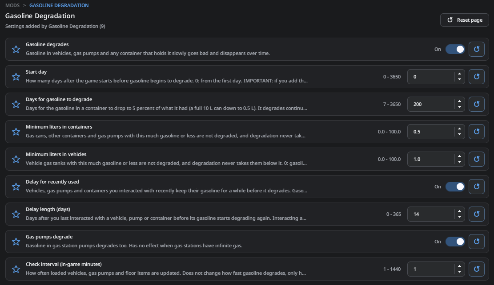

# Gasoline Degradation (Build 42)

Gasoline in the world degrades over time: vehicle tanks, gas pumps, and any item or world object with a fluid container holding `Fluid.Petrol` (including other mods', as long as they use the vanilla fluid/vehicle systems).

## Default decay (full 10 L gas can)

Gasoline decays continuously: every day each container loses the same share of what it still holds. "Days for gasoline to degrade" (default 200) is how long it takes to drop to 5% of what it had. The rate never depends on the date, so a can found on day 300 decays exactly like one on day 1.

| Days sitting | 0 | 7 | 30 | 60 | 90 | 120 | 150 | 200 | 300 |
|---|---|---|---|---|---|---|---|---|---|
| Liters | 10 | 9.0 | 6.4 | 4.1 | 2.6 | 1.7 | 1.1 | 0.5 | 0.5* |

\* never below the minimum (0.5 L containers / 1.0 L vehicles). Bigger stocks (car tanks, pumps) lose the same share per day, so they keep some fuel longer in liters.

## Screenshots

## Sandbox options

| Option | Default | What it does |
|---|---|---|
| Gasoline degrades | yes | On/off |
| Start day | 0 | Days of delay before degradation starts |
| Days for gasoline to degrade | 200 | Days to drop to 5 percent of what a container had (10 L → 0.5 L) |
| Minimum liters in containers | 0.5 | At or below this: ignored, never degraded below it |
| Minimum liters in vehicles | 1.0 | Same, for vehicle tanks |
| Delay for recently used | yes | Vehicles, pumps and containers you interacted with keep their gasoline for a while |
| Delay length (days) | 14 | Days after the last interaction before degradation resumes (interacting again restarts it) |
| Gas pumps degrade | yes | No effect with infinite gas |
| Check interval | 1 min | How often it is applied, not how fast it degrades |

## How it works

Each object stores the day it was last updated in its modData (`GD_t`); when seen again, its gasoline is multiplied by `0.05 ^ (days since GD_t / lifetime)`. Because the decay is exponential, the result is the same no matter how often or when an object is checked, so unloaded areas catch up when they load, with nothing running over the whole map.

- Every 10 game minutes: players' inventories.
- Every check interval (default every game minute): loaded vehicles and known pumps/barrels/floor items.
- When a square loads: pumps, barrels and floor items on it.
- When the loot window opens: the listed containers (once per 10 min each).
- Every 10 game minutes: gas cans on the floor within 12 tiles of a player.
- Freshly generated loot (`OnFillContainer`): caught up when it spawns.

First sighting: what the **world generated** (vehicles, gas pumps, loot spawned into containers) is caught up from the start of the clock, as if it had been degrading since the game began. A car in a corner of the map nobody visited until day 100 holds what 100 days of decay leave (with the 200-day default, about 22% of its tank). Anything a player may have touched (carried or dropped cans, containers opened in the loot window, placed barrels) is only stamped, so it is never degraded twice. When the mod is added mid-save the clock starts that day, so nothing is retroactively degraded.

## Recent access delay

With the delay on, a vehicle, gas pump or world container (crate, shelf, trunk...) you interacted with is skipped by degradation for the next N days. The delay window is simply cut out: the time before the interaction was already applied, the window is skipped, and degradation resumes afterwards from whatever amount is left.

What counts as an interaction:
- Someone sitting in a vehicle (checked every 10 game minutes).
- Fueling, siphoning or taking fuel from a pump (the vehicle and/or pump).
- Carrying gas cans (see below).
- Having a container open (selected) in the loot window.

Gasoline you carry (inventory and bags) does not degrade at all while carried. Every carried can is "touched" every 10 game minutes, so it keeps the same delay after you put it down, and then degrades normally. A can lying in a container follows the later of the container's and its own delay.

## Adding or removing mid-save

- **Adding:** the clock starts the day the mod first runs in the save (stored in global mod data), so nothing is retroactively degraded. In a new game that day is ~0.
- **Removing:** the save keeps working. Only tiny unused modData keys (`GD_t`, `GD_frac`) remain, and the mod's sandbox values stay in the save file, all harmless. Gasoline already lost is not restored.

## Testing locally

See [TESTING.md](TESTING.md). Set `GD.DEBUG = true` in `GD_Core.lua` for logs.

## Known limitations

- Only logic and syntax tested so far; in-game testing pending.
- Multiplayer is experimental: the server handles vehicles, pumps, new loot and inventories, but there is no loot window on the server, so old containers only update through the other paths.
- The delay from opening containers needs the loot window, so in multiplayer only vehicle and pump interactions count.
